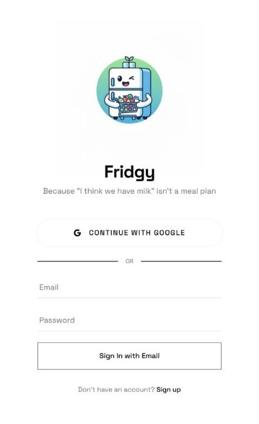

# Fridgy

> Because "I think we have milk" isn't a meal plan.

Fridgy is a mobile-first web app that keeps track of what is in your kitchen. You photograph a grocery receipt, it reads the items into your pantry, and it suggests recipes from what you already have.

It was built as a team project over a weekend in February 2026.



## What it does

- **Receipt scanning.** Take a photo or upload a picture of a receipt or shopping list. A vision model reads the text, a second pass turns it into clean grocery items with category, quantity and price. You review the list before anything is saved.
- **Pantry.** Items are grouped by category. Change quantities with plus and minus, and swipe a card to edit its details, delete it, or send it to the shopping list. Adding an item you already have raises its quantity instead of creating a duplicate.
- **Recipe chat.** Say what you feel like eating. The app sends your request together with your pantry and gets back up to five recipes, each split into the ingredients you have and the ones you are missing.
- **Shopping list.** Missing ingredients go to the list with one tap, tagged with the recipe they came from.
- **Spending dashboard.** Every scanned receipt is stored, with this month's total, the number of shopping trips and a spending-by-category chart.
- **Accounts.** Email and password or Google sign-in. Each user only sees their own data.
- **Installable.** Ships a web app manifest and icons, so it can be added to a phone's home screen.

## How it works

```
React app (Vite)
   |
   |-- Supabase Auth ............ sign-in, sessions
   |-- Supabase Postgres ........ fridge_items, shopping_list_items, receipt_history, profiles
   |                              (row level security: users can only touch their own rows)
   '-- Supabase Edge Functions
         |-- scan-recipe ........ image -> OCR text -> structured items (Gemini via an AI gateway)
         '-- suggest-recipes .... pantry + request -> recipes as JSON
```

Receipt scanning runs in two steps: the model first reads the receipt as plain text, then a second call turns that text into structured items with generic names (so "apples" from two brands end up as one pantry entry). If the first step returns almost no text, the function falls back to a single direct pass over the image.

## Tech stack

React 18, TypeScript, Vite, Tailwind CSS, shadcn/ui (Radix), Recharts, Supabase (Postgres, Auth, Edge Functions on Deno), Vitest.

The first version was prototyped in [Lovable](https://lovable.dev). This repository is the cleaned-up code.

## Run it locally

You need Node.js 20 or newer and a Supabase project.

```sh
npm install
cp .env.example .env    # then fill in your Supabase URL and publishable key
npm run dev             # http://localhost:8080
```

Set up the backend with the [Supabase CLI](https://supabase.com/docs/guides/cli):

```sh
supabase link --project-ref <your-project-ref>
supabase db push                              # creates the tables and policies
supabase functions deploy scan-recipe
supabase functions deploy suggest-recipes
supabase secrets set LOVABLE_API_KEY=<key>    # key for the AI gateway the functions call
```

Two parts depend on Lovable Cloud: the edge functions call Lovable's AI gateway (an OpenAI-compatible endpoint), and the Google sign-in button uses Lovable's auth helper. To run without Lovable, point `AI_GATEWAY_URL` in the functions at another OpenAI-compatible endpoint and switch the Google button to `supabase.auth.signInWithOAuth`. Email sign-in works on any Supabase project.

## Scripts

| Command | What it does |
| --- | --- |
| `npm run dev` | Start the dev server |
| `npm run build` | Production build into `dist/` |
| `npm test` | Unit tests |
| `npm run lint` | ESLint |
| `npm run typecheck` | TypeScript check |

## Project layout

```
src/
  pages/          Fridge (pantry), Recipes, ShoppingListPage, Dashboard, Login, Signup
  components/     item cards, add/scan dialog, recipe chat, bottom navigation
  contexts/       auth, pantry items, shopping list
  hooks/          data access for items, recipes and receipt history
  lib/            pure helpers (receipt statistics) and their tests
supabase/
  functions/      scan-recipe, suggest-recipes
  migrations/     database schema and row level security policies
```
